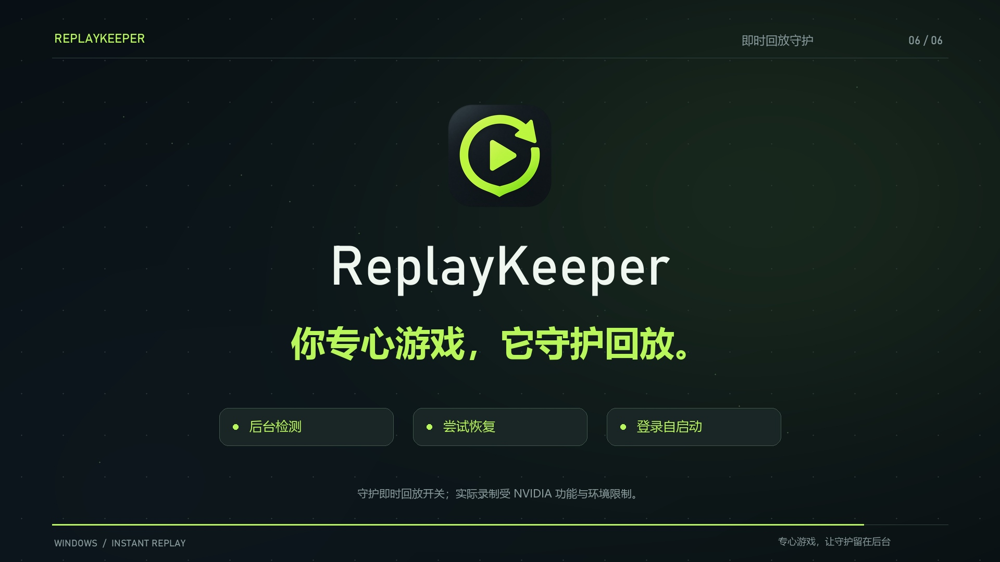

# ReplayKeeper

<p align="center"></p>

<p align="center"><strong>你专心游戏，它守护回放。</strong></p>

ReplayKeeper 是一个 Windows 托盘小工具，用来观察 NVIDIA 即时重放状态，并在确认其意外关闭后尝试用**你在 NVIDIA App 中配置的快捷键**重新开启。它不会退出 NVIDIA App、修改录制设置或改写全局快捷键。请先在 NVIDIA App 中启用游戏内浮窗，配置即时重放快捷键，并确认即时重放本身能正常使用。

GitHub 仓库名为 **RecordKeeper**，程序名称为 **ReplayKeeper**。

- 后台监测即时重放开关，确认关闭后尝试恢复，并复查结果。
- 当前用户登录后自启动，常驻通知区域，可随时暂停或退出。
- 状态未知时暂停操作，恢复失败时逐步延长重试间隔。

## 宣传片与下载

[](https://github.com/Kalsook041/RecordKeeper/raw/refs/heads/main/promo/ReplayKeeper-promo.mp4)

[观看 / 下载宣传片](https://github.com/Kalsook041/RecordKeeper/raw/refs/heads/main/promo/ReplayKeeper-promo.mp4) · [下载程序](https://github.com/Kalsook041/RecordKeeper/raw/refs/heads/main/dist/ReplayKeeper.exe) · [下载完整项目 ZIP](https://github.com/Kalsook041/RecordKeeper/archive/refs/heads/main.zip)

宣传片为 32 秒、1080p、30 fps，含中文旁白、原创电子配乐与动态字幕。[分镜、字幕和渲染源码](promo/README.md)一并保留。自动恢复部分为压缩时间的流程示意，状态界面使用制作时的真实快照。

单独运行下载的 exe 会启动托盘守护；需要安装到固定目录并启用登录自启动时，请下载完整项目，解压后运行下面的安装命令。

## 安装与使用

需要 Windows 10/11 x64、.NET Framework 4.7.2 或更新版本，以及能使用即时重放的 NVIDIA App/驱动。以当前 Windows 用户运行即可，无需管理员权限。安装脚本使用 Windows 自带的 .NET Framework x64 C# 编译器编译源码，生成单个 exe，不下载第三方依赖。

在本项目目录打开 Windows PowerShell，运行：

```powershell
powershell.exe -NoProfile -ExecutionPolicy Bypass -File .\install.ps1
```

脚本先构建，再将 `ReplayKeeper.exe` 安装到 `%LOCALAPPDATA%\ReplayKeeper\ReplayKeeper.exe`，为**当前用户登录后**设置自启动，并启动托盘程序。重复安装会先让当前登录会话中已安装的进程退出，等待退出后再覆盖 exe；若另一登录会话仍在运行同一安装文件，安装会报错，请先在那个会话退出程序。更新失败时，安装脚本会尝试恢复原 exe、自启动项和原运行状态，并保留旧 exe 备份以便排查。仅构建、不安装时运行：

```powershell
powershell.exe -NoProfile -ExecutionPolicy Bypass -File .\build.ps1
```

程序启动后留在通知区域，不弹主窗口。右键托盘图标可查看实时状态、暂停或恢复守护、切换登录后自启动、打开状态窗口或日志文件夹、退出。关闭状态窗口只会将其隐藏；选择托盘菜单中的“退出”会停止本次守护，但不会自动关闭登录后自启动。手动双击 exe 只会启动程序，不会擅自开启自启动。每个用户登录会话内重复启动只保留一个实例。

守护约每 3 秒检查一次。首次启动有约 20 秒宽限；叠加层变化后还会等待约 10 秒。只有连续两次明确读到即时重放关闭，且叠加层就绪、快捷键可用时，程序才尝试发送快捷键。尝试后等待约 9 秒确认；失败时按 30、60、120、300 秒逐级退避。状态未知、快捷键缺失、用户暂停或会话锁定时不会尝试恢复。因此程序不会在启动瞬间立刻切换即时重放，也不能保证每次都立即恢复。托盘“暂停”会让本次运行中的守护停止尝试恢复，直到选择“恢复”；“退出”会停止进程，直到手动再次启动或下次登录。

需要排查时，在托盘菜单打开日志文件夹，查看 `%LOCALAPPDATA%\ReplayKeeper` 下的日志及 `status.json`。也可运行以下只读诊断命令：它读取本机状态并写入同目录的 `diagnostics.json`，不启动托盘，也不发送恢复快捷键。

```powershell
& "$env:LOCALAPPDATA\ReplayKeeper\ReplayKeeper.exe" --diagnose
```

卸载请运行：

```powershell
powershell.exe -NoProfile -ExecutionPolicy Bypass -File .\uninstall.ps1
```

卸载脚本会通知当前登录会话中本项目已安装的进程退出、取消对应的当前用户自启动，并且只删除 `%LOCALAPPDATA%\ReplayKeeper\ReplayKeeper.exe`。若另一登录会话仍在运行同一安装文件，卸载会报错，需先在那个会话退出程序。日志、状态及诊断文件会保留在原目录，便于后续排查；若要删除这些个人文件，请自行检查后手动处理。

## 适用范围和限制

ReplayKeeper 依赖 NVIDIA App 当前暴露的状态字段和已配置的快捷键；这些状态字段不是 NVIDIA 提供的稳定公开 API，NVIDIA App 或驱动更新后可能改变，程序此时可能显示“未知”并暂停恢复。受保护内容、磁盘空间不足、录制存储故障、驱动异常或 NVIDIA 本身不允许录制的场景，也无法由守护程序解决。程序只尝试重新开启即时重放；已丢失的回放缓冲无法找回。登录后自启动不等于 Windows 开机前运行；重启后的自动运行仍需在目标电脑上实际验证。

设计参考：[AlwaysShadow 的状态读取与修复实现](https://github.com/Verpous/AlwaysShadow/blob/master/src/fixer.c)；[NVIDIA 关于浮窗、即时重放和默认快捷键的说明](https://www.nvidia.cn/geforce/news/nvidia-app-beta-update-av1-performance-tuning/)。前者是社区项目，后者仅说明 NVIDIA App 的用户功能；它们都不保证本工具在所有版本中的兼容性。

## 开发验证

图标采用深石墨底色、绿色回放箭头与播放符号。设计原图保存在 `assets\replaykeeper.png`，Windows 多尺寸图标保存在 `assets\replaykeeper.ico`，同时嵌入程序文件、托盘和状态窗口。需要从原图重新导出各尺寸时，运行 `tools\export-icon.ps1`。

运行 `powershell.exe -NoProfile -ExecutionPolicy Bypass -File .\test.ps1` 检查守护状态机、注册表格式、快捷键读取与 x64 输入结构。测试使用独立的临时注册表子树，本机 NVIDIA 状态检查为只读。

安装后可显式运行 `tests\InstallationTests.ps1` 验证安装失败回滚、卸载及重新安装。这项测试会短暂停止 ReplayKeeper，并在结束时保留守护运行和自启动；不会操作 NVIDIA 回放开关。已通过 54 个自动化断言以及安装回滚、卸载和重装验证；制作宣传片期间也观察到一次真实关闭后的恢复，日志复查确认开关重新开启。这不代表所有 NVIDIA 版本或录制场景均已验证；重启登录后的启动尚未实测。
